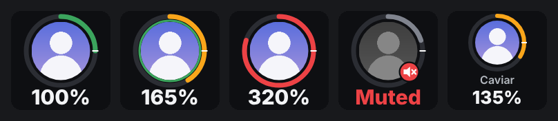
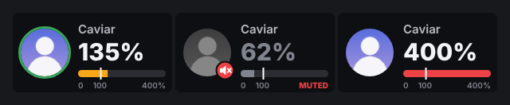

# Vencord User Volume Deck

Control **one specific person's Discord volume** from your Elgato Stream Deck — on a key or a Stream Deck + dial, with their avatar and the live volume right on the device.

This is the **Discord side**. It pairs with the [Discord User Volume Stream Deck plugin](https://github.com/CaviarTheCatgirl/streamdeck-user-volume).






## Features

- 🎚️ **Per-person volume** from the Stream Deck: the same setting as right-click → User Volume in Discord
- 🖼️ **Live key images**: avatar, a volume ring, the current volume, a muted badge and a green outline while they talk
- 🎛️ **Stream Deck + dials**: avatar, name, big volume number and a bar with a 100 % mark on the touch strip
- 🚀 **Respects your boost limit**: reads Vencord **VolumeBooster**'s multiplier live (multiplier 2 → 400 %)
- 🎯 **Same numbers as Discord's slider**: uses Discord's own perceptual volume curve, so "135 %" here is "135 %" there
- 👥 **Smart suggestions** in the Stream Deck settings: people in your call, people whose volume you changed, people you talk to most, recent DMs and friends
- 🔒 **Locked to your Stream Deck**: the local API refuses web pages (no website can change your volumes or read who you talk to)
- 💤 **Nothing running while disabled**: the local server only starts when the plugin is enabled

## How it looks

| | |
|---|---|
| **Ring / bar colour** | 🟢 up to 100 % · 🟠 up to 200 % · 🔴 above 200 % · white tick = 100 % |
| **Green outline** | They're talking right now |
| **Red speaker badge** | You muted them locally |
| **Grey "Discord off"** | Discord isn't running or the plugin is disabled |

## Requirements

- **Discord desktop app** (the plugin needs Vencord's native helpers, so the browser version can't run it)
- **[Vencord](https://vencord.dev/) built from source** (userplugins are compiled into your own Vencord build)
- **[Discord User Volume](https://github.com/CaviarTheCatgirl/streamdeck-user-volume)** Stream Deck plugin
- Optional: **VolumeBooster** (built into Vencord) for volumes above 200 %

## Installation

1. Download the [latest release](https://github.com/CaviarTheCatgirl/vencord-user-volume/releases/latest) or clone this repository.
2. Copy the folder into your Vencord source checkout as `src/userplugins/userVolumeDeck`:
   ```
   Vencord/
   └── src/
       └── userplugins/
           └── userVolumeDeck/
               ├── index.ts
               ├── native.ts
               ├── render.ts
               └── volume.ts
   ```
3. Rebuild and re-inject Vencord:
   ```bash
   cd path/to/Vencord
   pnpm build
   pnpm inject   # only needed the first time / after a Discord update
   ```
4. Restart Discord **fully** (quit from the tray, not just close the window). Native code is only loaded at startup.
5. Discord Settings → **Vencord → Plugins** → enable **UserVolumeDeck**.

### Then

Install the [Stream Deck plugin](https://github.com/CaviarTheCatgirl/streamdeck-user-volume), drag **User Volume** onto a key or a dial and pick a person.

## Configuration

Discord Settings → Vencord → Plugins → **UserVolumeDeck**:

| Setting | Default | What it does |
|---|---|---|
| **Port** | `37321` | Local port the Stream Deck plugin connects to. Must match the Stream Deck plugin's *Connection → Port*. Restart Discord after changing it. ([Krisp Toggle](https://github.com/CaviarTheCatgirl/vencord-krisp-toggle) uses `37320`, so both run side by side.) |
| **Volume numbers** | Same as Discord's slider | *Raw stored value (linear)* shows the amplitude Discord stores instead (see below). |
| **Max volume** | `0` (automatic) | Highest volume the Stream Deck may set, in %. Automatic = 200 %, times VolumeBooster's multiplier when that plugin is enabled. |

### About the volume numbers

Discord stores a user's volume as an **amplitude** (100 = unchanged) but its slider shows a **perceptual** value (it uses [`@discordapp/perceptual`](https://www.npmjs.com/package/@discordapp/perceptual): 50 dB range below 100 %, 6 dB of boost above it). So slider 200 % ≈ amplitude 199.5, and VolumeBooster's 400 % ≈ amplitude 794.

This plugin converts the same way, so the deck always shows what Discord's slider shows. Changing the volume on the deck moves Discord's slider, and the other way round.

## How it works

```
 Stream Deck plugin  ──HTTP + SSE──▶  native.ts (Discord main process)
   (Node.js)          127.0.0.1:37321        │  executeJavaScript
                                             ▼
                                   index.ts (Discord renderer)
                                   ├─ reads MediaEngineStore / SpeakingStore / VoiceStateStore
                                   ├─ sets volume & mute with Discord's own actions
                                   └─ render.ts draws key / touch-strip images on a canvas
```

- **`index.ts`** owns all Discord state. It changes volume and mute with `AUDIO_SET_LOCAL_VOLUME` / `AUDIO_TOGGLE_LOCAL_MUTE`, the same actions Discord's user menu uses, so the change is saved and synced like a normal slider move.
- **`render.ts`** draws finished PNG images on a canvas. The Stream Deck plugin never has to rasterize anything; it just displays what arrives.
- **`native.ts`** runs a tiny HTTP server in Discord's main process and keeps one Server-Sent-Events stream open per Stream Deck. Changes are pushed, not polled: turn the slider in Discord and the key updates instantly.
- Avatars are fetched by the main process (no CORS) and only from `cdn.discordapp.com` / `media.discordapp.net`.
- Updates are coalesced in a microtask, and only views whose picture actually changed are re-rendered and sent.

## Security

The API listens on `127.0.0.1` only, and refuses anything a web browser could send:

- Requests with an `Origin` header are rejected (browsers always send one cross-origin).
- POST bodies must be `application/json`, which forces a CORS preflight that never gets CORS headers back.
- The `Host` header must be `127.0.0.1:<port>` or `localhost:<port>`, which stops DNS-rebinding attacks.

So a website you have open can't change anyone's volume or read your suggestion list (which contains who you talk to).

## API reference

All endpoints are on `http://127.0.0.1:37321`.

| Method | Path | Body / query | Returns |
|---|---|---|---|
| `GET` | `/health` | | `{ ok, name, version, renderer }` |
| `GET` | `/events?client=<id>` | | Server-Sent Events: `hello`, `view`, `reset`, `status` |
| `GET` | `/status` | | `{ name, version, max, scale, me, voiceChannel }` |
| `POST` | `/views` | `{ client, views: [{ id, userId, context, kind, look }] }` | `{ ok, views }` |
| `POST` | `/adjust` | `{ userId, context, delta, detent? }` | `{ volume, max, muted, hitDetent, atLimit }` |
| `POST` | `/set` | `{ userId, context, volume }` | `{ volume, max, muted }` |
| `POST` | `/mute` | `{ userId, context, mode: "toggle" \| "on" \| "off" }` | `{ volume, max, muted }` |
| `GET` | `/suggestions` | | `{ me, max, scale, users: [{ id, name, username, avatar, tags, volume, muted }] }` |
| `GET` | `/user?id=<snowflake>` | | One user, fetched from Discord if not cached |

- `context`: `default` (their voice) or `stream` (their Go Live audio).
- `kind`: `key` (144 × 144 image) or `strip` (200 × 100 touch-strip image).
- `delta` / `volume`: on the configured scale. Volumes are clamped to `0 … max`, and turning **up** never pulls a volume that's already above the limit down.
- `detent`: a value (100) the volume stops at when crossing it. The response says `hitDetent: true`, and the Stream Deck plugin pauses there.
- A `view` event is `{ id, state, image }`, where `image` is a PNG data URL. `reset` means Discord reloaded and the client should send its views again.

## Troubleshooting

### Keys say "Discord off"
- Make sure Discord is running and **UserVolumeDeck** is enabled.
- After installing or updating, restart Discord **fully**. The native part only loads at startup.
- Check the ports match (plugin setting ↔ Stream Deck *Connection → Port*).

### "Stream Deck bridge did not start: Port 37321 is already in use"
Something else uses that port. Pick another port in the plugin settings, set the same port in the Stream Deck plugin, and restart Discord.

### The volume stops at 200 %
Enable **VolumeBooster** in Vencord and raise its multiplier, or set **Max volume** manually.

### The deck shows a different number than Discord's slider
Set **Volume numbers** back to *Same as Discord's slider*.

### Avatar shows initials instead of the picture
The avatar is still loading or couldn't be downloaded. It's retried automatically after a minute.

### Plugin not in the list
It must be inside `src/userplugins/`, and Vencord must be rebuilt with `pnpm build`.

## Development

```bash
git clone https://github.com/CaviarTheCatgirl/vencord-user-volume.git
cp -r vencord-user-volume path/to/Vencord/src/userplugins/userVolumeDeck

cd path/to/Vencord
pnpm build          # or: pnpm watch
pnpm test:ts        # type-check
pnpm lint
```

### Project structure

```
userVolumeDeck/
├── index.ts    # plugin: Discord state, views, API handlers, settings
├── native.ts   # main process: HTTP + SSE server, avatar fetch
├── render.ts   # canvas drawing of key and touch-strip images
├── volume.ts   # Discord's perceptual ↔ amplitude conversion
└── docs/       # README images
```

## License

GPL-3.0-or-later

## Credits

**Created by**: CaviarTheCatgirl

**Related projects**:
- [Discord User Volume for Stream Deck](https://github.com/CaviarTheCatgirl/streamdeck-user-volume): the required Stream Deck plugin
- [Vencord Krisp Toggle](https://github.com/CaviarTheCatgirl/vencord-krisp-toggle): Krisp on a Stream Deck key

Part of the [Vencord](https://vencord.dev/) ecosystem.

## Changelog

### v1.0.0 (initial release)
- ✨ Per-person volume and mute from Stream Deck keys and dials
- 🖼️ Live key and touch-strip images rendered in Discord
- 🚀 VolumeBooster-aware maximum
- 🎯 Discord-identical perceptual volume scale
- 👥 Suggestions: call, adjusted, frequent, DMs, friends
- 🔒 Browser-proof local API
